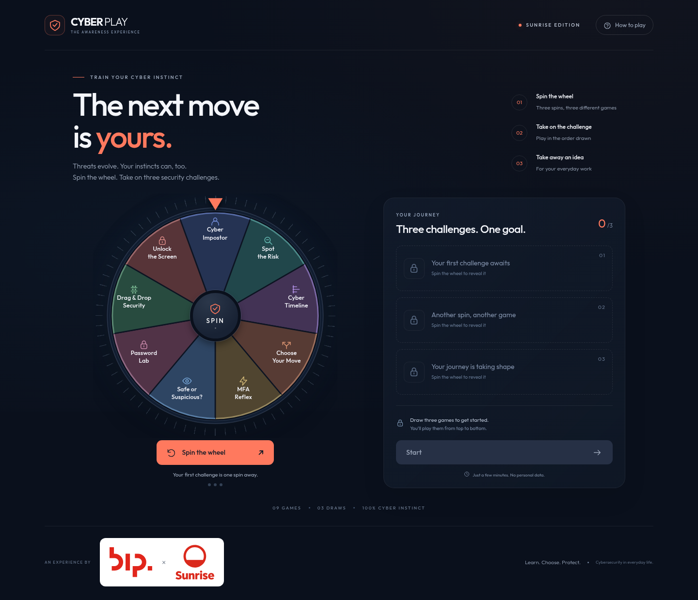

# Chatgpt

## Cyber Play — BIP × Sunrise

An English-language cybersecurity awareness game with an animated wheel, three unique random draws and nine interactive mini-games.

The full project is in **[sunrise-cyber-game](sunrise-cyber-game/README.md)**.

### Download and play

1. Select **Code → Download ZIP** on this repository.
2. Extract the entire ZIP.
3. Open **`sunrise-cyber-game/index.html`** in a current browser.

Alternatively, open [Sunrise_Cyber_Play_EN.html](sunrise-cyber-game/Sunrise_Cyber_Play_EN.html) on GitHub and use **Download raw file**. The downloaded HTML contains the entire game and can run on its own.

The game works offline and requires no accounts, API keys or installation. Source code, local assets, the bundled password estimator, previews, development tests and build instructions are included. This repository contains the files; GitHub Pages hosting has not been enabled.

To test any game freely, press **Ctrl + Shift + G** (**Cmd + Shift + G** on Mac), or click the footer **Learn. Choose. Protect.** three times quickly. Enter **`Gabriele&Alessia`** and select **Unlock games**. See [hidden test mode](sunrise-cyber-game/README.md#hidden-test-mode) for replay and exit controls.

The footer displays the BIP and Sunrise logos in white on the dark background; see [asset provenance](sunrise-cyber-game/README.md#logos). Password Lab replaces Cyber Memory, with local strength feedback and an introduction to password managers such as KeePass.

